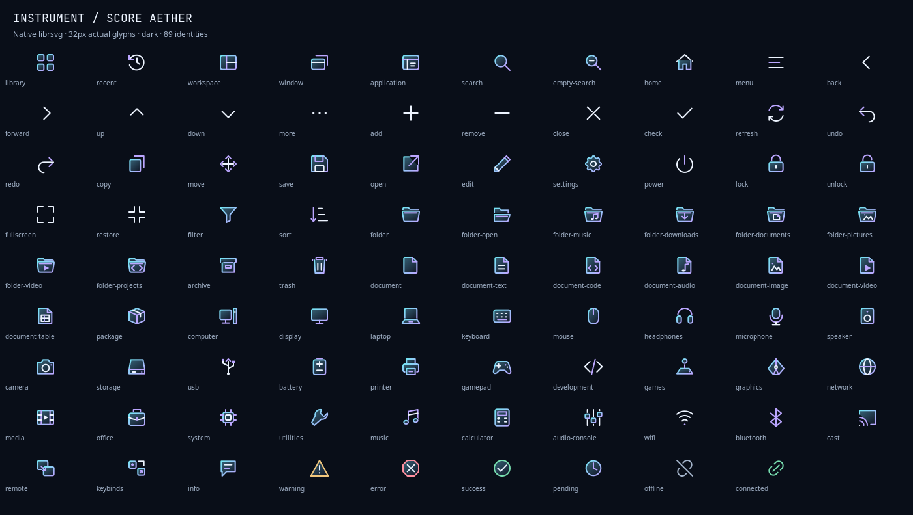
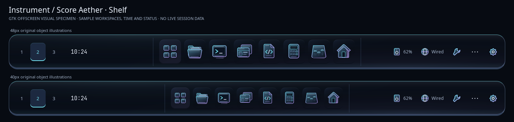
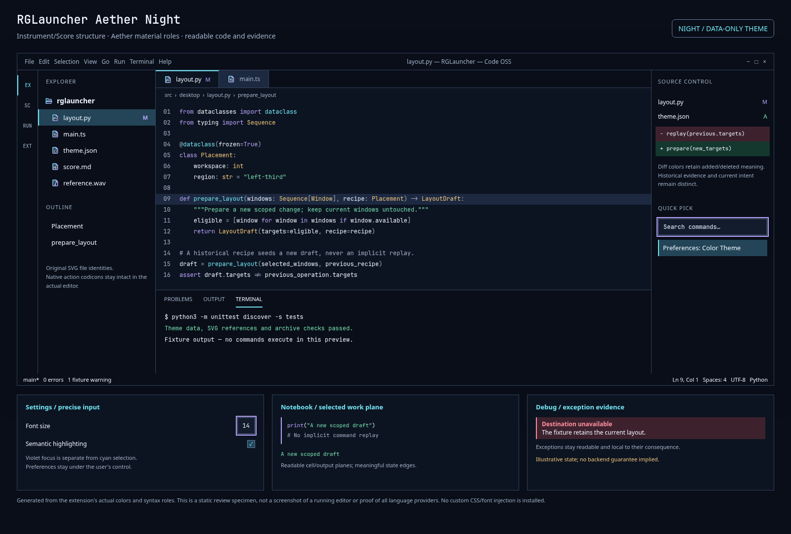

# RGLauncher: Linux Edition

An MIT-licensed desktop shell for **Hyprland and Waybar**, using the
Instrument/Score Aether design language. Applications become instruments; the
launcher, windows and shelf provide their shared score. Quiet dark materials,
cyan selection, violet focus and readable controls support work, music and play.

This is a Linux product built on an existing compositor. It is an early alpha,
separate from the Windows Edition. Its original shell, theme, icons, calculator,
audio interface and update client are free software. System applications and
libraries keep their own licenses.



Original SVG icon contact sheet rendered with librsvg. This is a generic asset
specimen, not a screenshot of an installed desktop.

Included software provides:

- An application launcher and window overview with explicit scope and search.
- A bottom-edge Waybar shelf: reveal it at the edge or through a command; native
  tray menus keep their own actions. It reserves no permanent work area.
- A calculator, Audio Console, NetworkManager and BlueZ controls.
- Thunar file-manager and Kitty terminal integration.
- Original GTK/Qt/Tk adapters, semantic SVG icons and three VS Code themes.
- Signed per-user software updates and retained local rollback releases.

The opt-in Hyprland Lua example preserves Super+number workspaces, Super+F
fullscreen, Super+C close, Super+drag/resize, tiled halves/quarters and Shift
thirds. Alt+Tab changes focus away from a game's active pointer constraint.
See [session setup and exact shortcuts](docs/hyprland-session.md). Installing the
software does not replace an existing compositor configuration.



GTK visual specimen with sample values; actual Waybar behavior is verified separately.

The shelf now uses a bounded deck with dimensional instrument icons, compact
workspace context and a searchable tools chooser. See [the visual and interaction
construction](docs/shelf-design.md) and [Control Room](docs/control-room.md).

## Try the command surface

The target is a Wayland session using Hyprland's 0.56 Lua API. Install distribution
dependencies first; see [software, dependencies and licenses](docs/software.md).

```sh
python3 -B bin/rglauncher doctor --json
python3 -B bin/rglauncher apps
python3 -B bin/rglauncher settings
```

Those UI commands open real interfaces when deliberately invoked. Automated QA
uses isolated data roots, offscreen rendering and fake callbacks instead.
No personal monitor layout, server, network identity or HCP installation is
required. The generic defaults live in `share/waybar`; desktop entries use
`rglauncher <command>` rather than private executable paths.

The initial Arch Linux x86_64 alpha channel uses signed GitHub release artifacts.
Obtain the source and publisher key from the [project repository](https://github.com/RobertRGreen/rglauncher-linux).
Verify the publisher key through a trusted route before installing:

```sh
python3 -B bin/rglauncher install \
  --feed https://raw.githubusercontent.com/RobertRGreen/rglauncher-linux/main/updates/prerelease.json \
  --public-key share/update-keys/rglauncher-2026.pub --channel prerelease \
  --enable-autoupdate
```

Use an absolute `file:///.../feed.json` URL and `--allow-file` for a deliberately
local signed development feed. Automatic updates are opt-in; omit
`--enable-autoupdate` to install manually. [Update documentation](docs/updates.md)
explains signatures, the pinned key, channels, activation order and rollback.

## Build and verify

```sh
python3 -m unittest discover -s tests -v
python3 tools/build_release.py --kind binary --version 0.2.0-alpha.3 \
  --output /path/to/new-output
```

The release builder uses a curated file list rather than archiving a home
directory. Binary packages can include the pinned patched Waybar backend;
[its source recipe](packaging/waybar/README.md) records upstream revision, license
and local patches. The builder creates an inventory and unsigned release data;
publishers must sign using their own protected key before distributing updates.
[The Arch recipe](packaging/arch/PKGBUILD) accepts the resulting local runtime
archive and a supplied, verified SHA-256. A source checkout needs a matching native
backend build before producing a runtime archive; see [installation](docs/installation.md).

Native surface details and bounded test limits are in
[native adapters](docs/native-theme.md) and
[VS Code themes](docs/vscode-theme.md). The project does not claim that private
web canvases, every toolkit or every hardware configuration automatically follows
the theme. Third-party application rendering remains under its owner's control.



Static workbench specimen generated from the VS Code theme's colors and original
SVG file icons. It illustrates the visual language; it is not a running-editor
capture or proof of every extension's rendering.

[Maintainer releases and public CI](docs/releasing.md) explains source checks,
native backend verification, protected signing, artifact-first publication and
manual signing-key rotation. CI checks source and theme data; it does not sign
or publish desktop updates.
